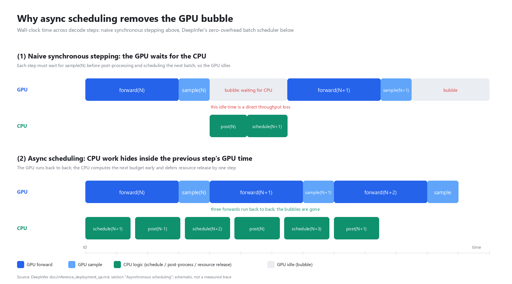

# DeepInfer Notes

Notes on [DeepInfer](https://github.com/deepseek-ai/DeepInfer), the inference
framework DeepSeek open-sourced in October 2026, and on the cost of a 128-GPU
deployment.

The notes are based on the repository source (`policy.py`, `llm_engine.py`) and
on `doc/inference_deployment_qa.md`, with cost figures derived from the published
numbers.

## Contents

| File | Description |
|---|---|
| [`deepinfer-deep-dive.md`](deepinfer-deep-dive.md) | Main write-up: architecture, load balancing, scheduling, cost |
| [`deepinfer-128gpu-cost-model.xlsx`](deepinfer-128gpu-cost-model.xlsx) | Editable cost model; change the yellow cells and the sheets recompute |
| `figs/async_pipeline.png` | Diagram of the scheduling overlap |
| `figs/` (four other images) | From the DeepInfer repository, see [NOTICE](NOTICE) |
| `scripts/` | Scripts that generate the diagram and the spreadsheet |

The runnable side of this work is in
[eplb-lab](https://github.com/demianemilesinclair/eplb-lab): the EPLB policy
reimplemented in NumPy, with 24 experiments and no GPU requirement.

## Figures used in the write-up

| Metric | Value | Source |
|---|---|---|
| Cluster throughput | 155 trillion tokens/day | Official Q&A |
| Revenue per GPU-hour | 38 USD, off-peak pricing | Official Q&A |
| Minimum efficient unit | 64 prefill + 64 decode GPUs | Official Q&A |
| Measured decode moe_lb | 1.045 to 1.090 | Official Q&A |
| Daily cost, 128 GPUs at 2.5 USD/GPU-hr | 7,680 USD | Derived |
| Cost per million tokens, full load | 0.048 USD | Derived |
| Break-even utilisation | 6.6% | Derived |

The cost figures are estimates derived from public numbers. They are not
DeepSeek's financial data. Assumptions are listed with each table in the
write-up and in the spreadsheet.

## License

- Written analysis: CC BY-NC-SA 4.0, see [LICENSE](LICENSE)
- Four images in `figs/` and quoted code: from DeepInfer, Apache-2.0, see [NOTICE](NOTICE)
- Scripts: MIT

---

Written against the `main` branch as of 2026-10-25.
