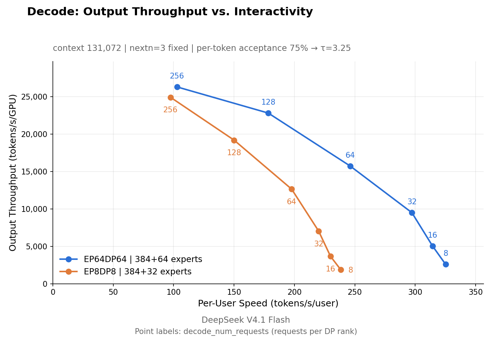

# DeepInfer: architecture, load balancing, scheduling, and cost

DeepSeek open-sourced DeepInfer in October 2026, under Apache-2.0. It is the
inference framework behind DeepSeek V4.1 Flash. This note covers how the system
is organised, which parts of the source implement each design decision, and what
a 128-GPU deployment costs to run.

The figures marked "official" come from the repository and
`doc/inference_deployment_qa.md`. The cost section is derived from those numbers,
and its assumptions are stated with each table.

## 0. Summary

- A single cluster serves 155 trillion tokens per day, at a reported 38 USD of
  revenue per GPU-hour under off-peak pricing.
- Prefill and decode are deployed separately. Prefill runs at EP2 to EP8, decode
  at EP64 to EP128. The smallest efficient unit is 64 prefill GPUs and 64 decode
  GPUs.
- Expert parallelism at this width depends on load balancing. With EPLB, the
  measured ratio of slowest rank to mean rank is 1.045 to 1.090.
- Asynchronous scheduling overlaps CPU scheduling with GPU execution, removing
  the idle interval between decode steps.
- 128 GPUs at 2.5 USD per GPU-hour cost 7,680 USD per day. At full load this is
  0.048 USD per million tokens, and break-even occurs at 6.6% utilisation.

## 1. Design goals

The deployment Q&A states three goals:

1. Support accelerators from more than one vendor. The repository ships kernel
   backends for NVIDIA SM100 and Huawei Ascend 950.
2. Organise prefill and decode around commodity hardware: 8-GPU machines for
   prefill, 64 to 128 GPU supernodes for decode.
3. Retain KV cache for more than 72 hours, to raise prefix hit rates and avoid
   repeated prefill.

The third goal also shapes the storage design. Retaining cache reduces the amount
of prefill that has to be recomputed, so cache hit rate acts as additional compute
capacity.


Official architecture diagram. At the top, deepseek-recipe converts JSON
requests into token lists and back. The red boxes are entrypoints. The three blue
boxes are the vision encoder, prefill and decode load balancers. Below them sit
three separately deployed services. Both the prefill and the decode service
contain their own expert-parallel load balancer. At the bottom is the KV cache
cluster on 3FS.

Load balancing is not a single cluster-wide component. Each engine type runs its
own EPLB with its own parameters, which is why the two sides use settings an order
of magnitude apart.

Published deployment figures:

| Item | Value |
|---|---|
| Prefill parallelism | EP2 to EP8, DP2 to DP8 |
| Decode parallelism | EP64 to EP128, DP64 to DP128 |
| Vision encoder | One GPU per instance; cheaper GPUs recommended |
| Tensor / context parallelism | Not used |
| Prefill to decode GPU ratio | About 1:1 |
| Minimum efficient unit | 64 prefill + 64 decode |
| Prefill to decode interconnect | About 400 Gbps per 8 GPUs |
| KV storage | About 100 PiB of SSD; 14.4 TB logical per GPU |

Tensor and context parallelism are not used. Tensor parallelism requires an
all-reduce, which is expensive relative to the compute it enables when batches
are small and the workload is memory-bound, as in decode. DeepSeek allocates
parallelism to experts instead, which reduces the weights each GPU reads per
step.

## 2. Expert parallelism in decode

MoE decode is memory-bound. Each emitted token requires reading the weights of
the selected experts, and that cost is almost independent of how many requests
are in the batch.

Two quantities follow from the layout:

- weights read per GPU equals total weights divided by EP;
- compute per token scales with batch size.

Moving from EP8 to EP64 reduces the experts held per GPU from one eighth to one
sixty-fourth, so the weights read per step fall by a factor of eight. All-to-all
traffic increases, but decode already waits on memory, so communication can be
overlapped with computation.

The constraint is the communication domain. EP64 requires 64 GPUs in one
scale-up domain, either NVLink or a supernode. Spanning domains removes most of
the benefit.



Official decode Pareto curve. The horizontal axis is per-user speed
(interactivity), the vertical axis is output throughput per GPU. Labels show
concurrent requests per DP rank.

Reading the curve point by point separates two effects that are often conflated:

- At the throughput end, around 100 tokens/s/user, EP64 reaches about 26,300
  tokens/s/GPU against 24,900 for EP8, a difference of 5%.
- At the interactivity end, around 250 tokens/s/user, EP64 reaches about 15,800
  while EP8 falls to about 2,800.

The gain from wider EP appears in the low-latency region, not at maximum
throughput. Production runs between the two extremes, where the latency users
accept sets the throughput that can be sold, so the operating point is closer to
the second case. This is consistent with the guidance to use the largest EP the
GPUs allow for decode.

The legend also gives the expert counts: `EP64DP64 | 384+64 experts` and
`EP8DP8 | 384+32 experts`. The smaller EP carries more redundancy per GPU.

## 3. Expert-parallel load balancing

The larger the EP, the more a single hot expert constrains the whole group. An
expert resides on one GPU, or on its replicas. If 30% of a layer's tokens route
to one expert, the GPU holding it determines the step time, and the other 63
GPUs wait.

EPLB addresses this with three operations: choose which experts receive replicas,
place the replicas on GPUs, and move weights when the plan changes.

### 3.1 Terminology

The comment at the top of `moe.py` defines the terms:

- logical: routed experts defined by the model (`n_routed_experts`);
- extra: redundant replicas (`n_redundant_experts`);
- physical: weight rows allocated, equal to logical plus extra, divisible by EP;
- local: experts per GPU, equal to physical divided by EP.

The divisibility requirement comes from all-to-all dispatch, which needs the same
number of slots on every GPU. The helper that enforces it:

```python
def resolve_num_extra_experts(num_routed_experts, min_num_extra_experts, ep_size):
    """Round up so num_physical_experts is divisible by ep_size."""
    padding = -(num_routed_experts + min_num_extra_experts) % ep_size
    return min_num_extra_experts + padding
```

The expert count can be read off the published figure. The legend states
384+64 for EP64 and 384+32 for EP8, which gives:

- 384 routed experts;
- at EP64, 64 redundant copies, one per GPU, so physical is 448 and each GPU
  holds 7. This matches the "7 experts per GPU" in the Q&A;
- at EP8, 32 redundant copies, four per GPU, so physical is 416 and each GPU
  holds 52.

### 3.2 Selecting experts for replication

`rebalance_experts_global` in `eplb/policy.py` adds replicas one at a time. Each
round selects the expert whose additional copy reduces the maximum per-replica
load the most.

```python
tokens_per_expert_all_diff = tokens_per_expert + arange_logical * 1e-4
score = tokens_per_expert_all_diff / logical_count
score_added = tokens_per_expert / (logical_count + 1)
values, indices = score.max(-1, keepdim=True)
values = values.expand_as(score).contiguous()
score.scatter_(-1, indices, score_added.gather(-1, indices))
values.scatter_(-1, indices, score.max(-1, keepdim=True).values)
redundancy_indices = values.sum(0).argmin(-1)
```

For each historical step the code computes the maximum per-replica load under the
candidate assignment, sums across steps, and takes the argmin. The `1e-4` offset
breaks ties, because `argmax` over equal values is not a defined choice and a
small bias is cheaper than a tie-break branch.

The objective is computed per layer. Hot experts in different layers are
independent, so each layer receives its own replication plan.

### 3.3 Placing replicas on GPUs

Replication decides which experts get a copy. Placement decides which GPU holds
each copy. `_batch_greedy_indices` minimises the sum over steps of the maximum
rank load:

```python
torch.add(loads, vector.unsqueeze(1), out=candidates)
torch.maximum(candidates, peaks.unsqueeze(1), out=candidates)
torch.sum(candidates, dim=-1, out=scores)
scores.masked_fill_(occupancy == capacity, float("inf"))
rank = scores.argmin(dim=-1)
```

The objective uses the maximum rather than the mean because each decode step ends
when the slowest GPU finishes, so an even average does not help.

Ranks that already hold `capacity` experts are masked out. Slots per GPU are
fixed, so no rank can be overbooked.

### 3.4 Moving weights

The first two operations are arithmetic. The third moves weights, and its cost
determines how often the plan can change.

Within a node, DeepInfer allocates symmetric memory buffers through
`torch.distributed._symmetric_memory` and shuffles over IPC, reading and writing
peer memory directly. Only one layer of weights is mirrored, refreshed layer by
layer during the shuffle. Across nodes it falls back to
`expert_model_parallel_shuffle_inplace`.

The source also calls `torch.cuda.empty_cache()` before the first rearrangement to
avoid running out of memory. The constraint on EPLB is the bandwidth and memory
peak of the move, not the scheduling algorithm.

### 3.5 Rearrangement cadence

| | Prefill | Decode |
|---|---|---|
| Starting redundancy | 4 per GPU | 1 per GPU (7 after rounding at EP64) |
| Statistics window | 100 steps | 1,000 steps |
| Rearrangement interval | 1,000 steps | 10,000 steps |
| Measured `moe_lb` | 1.074 (EP4DP4) / 1.045 (EP2DP2) | 1.090 |

The difference follows from the workload. A prefill step processes thousands of
tokens, so the expert distribution changes quickly and the window is short. A
decode step produces one token per sequence, so a longer window reduces the noise
in the estimate.

The interval differs by a factor of ten because moving 448 slots of expert weights
is expensive, especially across nodes.

The first rearrangement is scheduled at a quarter of the interval:

```python
# First rearrangement at 1/4 of the interval: fix the cold-start skew early.
initial_rearrangement_delay = max(1, self._rearrangement_interval // 4)
```

At cold start there is no history, so the layout is arbitrary. Waiting a full
period leaves that layout in place longer than necessary.

Metric reporting and rearrangement are decoupled. `DEEPINFER_MOE_LB_STAT_INTERVAL`
defaults to 128; every 128 steps an all-gather collects per-rank token counts and
computes `moe_lb`, without changing the layout.

### 3.6 Interpreting the measured value

`moe_lb` is the token count on the slowest rank divided by the mean across ranks.
A value of 1.090 means the slowest GPU handles 9% more work than average. In a
64-GPU group this is a narrow tail.

For reference, MoE load tails of 1.5 to 2 are common without balancing, according
to public reports rather than measurement in this note. The significance of 1.09
is that it removes a bottleneck that would otherwise make a 64-GPU deployment
uneconomic.

The Q&A also states that deployment reaches about 80% of a perfectly balanced
offline benchmark. The remaining 20% covers request long tails, cache misses and
machine variation.

## 4. Asynchronous scheduling

### 4.1 Source of the idle interval

A decode step proceeds as:

```
schedule(N) -> forward(N) -> sample(N) -> post-process(N)
```

Scheduling and post-processing are CPU work. Post-processing cannot start until
`sample(N)` returns, which requires a GPU-to-CPU synchronisation. During that
synchronisation the GPU has nothing to execute.


Top: synchronous stepping. Bottom: asynchronous scheduling, with CPU work moved
into the previous step's GPU time.

### 4.2 Overlap

The pipeline used in production:

```
GPU:  forward(N)  ->  sample(N)  ->  forward(N+1)  ->  sample(N+1)
CPU:  schedule(N+1) -> launch_forward(N+1) -> post-process(N-1) -> launch_sample(N+1)
```

Post-processing handles step N-1 rather than step N. Since only the previous
result is needed, no synchronisation on the current step is required, and
`forward(N+1)` can start immediately.

The cost is one additional step of end-to-end latency and a more complex state
machine. The source contains a class for the resource handling:

```python
class DeferredRelease:
    """Release a step's resources one round later, so the caller can finish reading.

    Resources are collected here and released at the next pre_sampler_sync, overlapping GPU compute.
    """
```

The engine does not run the pipeline serially. It passes
`EngineCallbacks(post_process_fn=self.post_process, pre_sampler_sync_fn=self.pre_sampler_sync)`
to the worker, which invokes `post_process` after the sample event. The overlap
is implemented with events, callbacks and deferred release, not with threads.

### 4.3 Scheduling without the current result

With the pipeline overlapped, the CPU schedules the next batch before the current
step's output exists, so the number of draft tokens to verify per request cannot
be read from the host.

The decision is split. The CPU fixes the total verification budget for the step.
Per-request lengths are computed on the GPU, because the confidence values are
not yet available. A TileLang kernel performs a cumulative product, a global sort
for top-k and a fused remap scatter, and writes the result to a pinned buffer.

The general constraint is that any decision depending on the current step's output
has to run on the GPU. Overlapping computation while leaving such decisions on
the CPU reintroduces the synchronisation.

## 5. Related mechanisms

### 5.1 SWA bounded replay

V4.1 uses separate encoder and decoder stacks. Decoder block KV is projected from
the last encoder layer's hidden state, so only the decoder's SWA KV has to be
recomputed per layer. Reconstructing it exactly requires running the last 2,560
tokens through 20 decoder layers.

DeepInfer recomputes the last 128 tokens and truncates the attention window to
the replayed segment. The query at position i attends to keys between max(s,
i-127) and i. The result is an approximation of the SWA KV cache.

Three constants follow:

- 128 is the SWA window length and the storage granularity. Only positions that
  are multiples of 128 are stored.
- 134 equals 128 plus 6. The maximum hit length is L minus 134. The extra 6
  positions cover speculative decoding backtracking and fit in the ring buffer's
  additional slots.
- 140 is the default number of tokens retained when decoder prefill is truncated
  (`DEEPINFER_YOCO_PREFILL_KEEP_TOKENS=140`).

Decoder prefill drops from 2,560 tokens to 128, and total prefill compute is
approximately halved. The approximation affects only the segment that does not
enter the prefix cache.

The per-sequence SWA spill is 20 layers by 134 tokens by 528 bytes, or 1,415,040
bytes.

### 5.2 Batch invariance and deterministic sampling

Inference frameworks generally do not guarantee batch invariance. The same
request placed at position 3 or position 30 of a batch can produce different
output because the floating-point summation order differs.

DeepInfer exposes both settings:

```bash
export DEEPINFER_BATCH_INVARIANT=1
export DEEPINFER_ENABLE_MTP_VARLEN=0   # deterministic sampling also disables variable-length speculation
```

A fixed `seq_seed` in `SamplingParams` then produces identical output for
identical input tokens and sampling parameters.

In production this gives reproducible debugging and reproducible evaluation, which
is used for reinforcement learning, regression tests and A/B comparisons.

### 5.3 Structured output

Compilation and serving are separated. JSON Schema, regular expressions and EBNF
grammars are compiled into automata asynchronously on dedicated machines. A
request retrieves the compiled artifact before entering the engine. At runtime a
decode step advances the automaton, builds a mask and applies it to sampling.

Compilation takes milliseconds to seconds and is CPU-bound; decoding takes
microseconds and is GPU-bound. Running them on separate paths keeps structured
output off the critical path.

## 6. Cost of a 128-GPU deployment

The figures in this section are estimates derived from published numbers. They
are not DeepSeek's financial data.

### 6.1 Unit specification

| Item | Value |
|---|---|
| GPUs | 64 prefill (EP4 to EP8) and 64 decode (EP64) |
| KV cache | 14.4 TB per GPU, 1.84 PB logical for 128 GPUs; about 2.2 PB physical with 10+2 erasure coding |
| Storage servers | 20 x 30.73 TB, about 615 TB usable each; 4 servers for this unit |
| Interconnect | About 400 Gbps per 8 GPUs |
| Output at full load | 14,466 tokens/s/rank times 128, about 160 billion tokens per day |

### 6.2 Rental cost

| Price | Per hour | Per day | Cost per million tokens, full load |
|---|---|---|---|
| 2.0 USD / GPU-hr | 256 USD | 6,144 USD | 0.038 USD |
| 2.5 USD / GPU-hr | 320 USD | 7,680 USD | 0.048 USD |
| 4.0 USD / GPU-hr | 512 USD | 12,288 USD | 0.077 USD |
| 6.0 USD / GPU-hr | 768 USD | 18,432 USD | 0.115 USD |

### 6.3 Implied price and break-even

The published figure is 38 USD of revenue per GPU-hour under off-peak pricing.
Applied to 128 GPUs:

- revenue at full load is 128 times 38, or 4,864 USD per hour, about 117,000 USD
  per day;
- the implied price is 4,864 divided by 6,666 million tokens per hour, or about
  0.73 USD per million tokens.

The two numbers are consistent with each other. The implied price is a blended
figure: it does not separate input from output tokens, does not account for cache
hits, and excludes storage and network cost.

Break-even is the rental price divided by 38, assuming revenue scales linearly
with utilisation:

| Rental price | Break-even utilisation |
|---|---|
| 2.0 USD / GPU-hr | 5.3% |
| 2.5 USD / GPU-hr | 6.6% |
| 4.0 USD / GPU-hr | 10.5% |
| 6.0 USD / GPU-hr | 15.8% |

Two consequences follow.

The margin between 0.73 USD and 0.048 USD per million tokens is a factor of 15,
so a small fraction of sold capacity covers the hardware cost.

The limiting factor is therefore utilisation rather than hardware cost. Moving
from 6% to 60% utilisation requires customers, latency control, cache hit rate
and uptime.

For scale: 155 trillion tokens per day divided by 160 billion per unit gives about
970 units, or roughly 120,000 GPUs. This is arithmetic on the published numbers,
not a disclosed figure.

### 6.4 Cost of an initial validation

- 128 GPUs for one week at 2.5 USD per GPU-hour: 53,760 USD.
- One month: 230,400 USD.
- Plus storage servers, networking and operations staff.

The arithmetic is in `deepinfer-128gpu-cost-model.xlsx`. Edit the yellow cells on
the Assumptions sheet to substitute different rental prices, throughput or
utilisation.

## 7. Scope of the open-source release

The Q&A states that KV cache management and load balancing are tightly coupled to
internal infrastructure and are not fully open-sourced. In the repository:

- `offline_inference.py`, benchmarks and evaluations are present; there is no API
  server;
- the prefill, decode and vision encoder load balancers are described in prose,
  not shipped as code;
- 3FS and kvcache-store are separate systems;
- EPD disaggregation and cross-replica balancing are implemented on the engine
  side, but not on the platform side.

The release provides a single-instance inference engine and a description of the
cluster design. It does not provide a serviceable multi-tenant system.

## 8. Notes for practitioners

1. Decode structure at EP64 assumes 64 GPUs in one scale-up domain. Raising EP on
   a small machine increases all-to-all traffic faster than it reduces weight
   reads.
2. The scheduling algorithm in EPLB is a small amount of code. The work is in
   moving weights without interrupting inference.
3. Overlapping scheduling pays in proportion to the CPU work it hides. A schedule
   step of tens of microseconds leaves little to overlap; one of several
   milliseconds leaves a lot.
4. Prefix caching substitutes cache hits for prefill compute. Reducing TTL from
   7 days to 3 days costs chatbot traffic 0.5% to 1% of hit rate.
5. Break-even utilisation of 5.3% to 15.8% reflects hardware cost against
   published revenue per GPU-hour. It assumes the capacity can be sold.

## Appendix A: running the engine

```bash
# Linux, GCC 13 or newer, Python 3.12, CUDA 13, SM100 GPUs
export DEEPINFER_ACCELERATOR=nvidia
./build.sh

# Pulls deepseek-ai/DeepSeek-V4.1-Flash-1017 by default
python examples/offline_inference.py
```

Source files relevant to the sections above:

| File | Contents |
|---|---|
| `deepinfer/model_executor/eplb/policy.py` | Replication and placement objective functions |
| `deepinfer/model_executor/eplb/__init__.py` | Window, interval, cold-start correction, metric definitions |
| `deepinfer/model_executor/eplb/shuffle.py` | Symmetric-memory IPC shuffle |
| `deepinfer/engine/llm_engine.py` | Async step, `DeferredRelease`, callbacks |
| `deepinfer/model_executor/models/v4_modules/moe.py` | logical / physical / local semantics |
| `doc/inference_deployment_qa.md` | Design decisions and measured figures |

## Appendix B: sources

- Repository: <https://github.com/deepseek-ai/DeepInfer> (Apache-2.0)
- Deployment Q&A: `doc/inference_deployment_qa.md`
- Official blog: DeepSeek's Zhihu post on the V4.1 Flash inference system
- Protocol layer: <https://github.com/deepseek-ai/deepseek-recipe> (MIT)

Figures marked "official" come from these sources. The cost tables, break-even
analysis and scale extrapolation are estimates, with assumptions stated
alongside.

---

Written against the `main` branch as of 2026-10-25.
